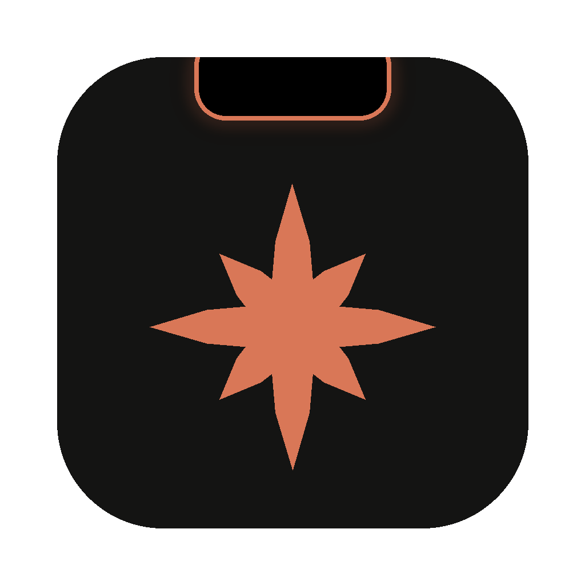

<p align="center"></p>

<h1 align="center">Notchwerk</h1>

<p align="center"><em>für Claude Code</em></p>

<p align="center">Ein orangener Rand um den Notch deines MacBooks, der aufklappt sobald Claude dich braucht.</p>

Notchwerk ist eine kleine, kostenlose Mac App für die Menüleiste. Sie zeigt dir am Notch (oder oben rechts auf einem externen Bildschirm) was Claude Code gerade macht. Wenn Claude eine Freigabe braucht oder eine Frage hat, klappt der Notch mit einer Animation auf und du kannst direkt dort antworten. Das funktioniert auch über Vollbild-Apps und Filmen.

> Inoffizielles Hobbyprojekt. Nicht von Anthropic und nicht mit Anthropic verbunden. „Claude“ und „Claude Code“ sind Marken von Anthropic, PBC und werden hier nur beschreibend genannt, weil die App mit Claude Code zusammenarbeitet. Lizenz: MIT, ohne Gewähr (siehe `LICENSE`).

## Einrichten in 3 Minuten

**Das brauchst du:** einen Mac mit macOS 13 oder neuer und Claude Code (im Terminal, in VS Code oder im Code-Tab der Claude App). Notchwerk kostet nichts, braucht kein eigenes Konto und hat keine Telemetrie.

**Weg A: fertige App herunterladen (am schnellsten)**

1. Auf der Seite [Releases](https://github.com/JakobWeigand/notchwerk/releases/latest) die Datei **`Notchwerk.zip`** laden.
2. Terminal öffnen und diese Zeile einfügen. Sie entpackt die App, legt sie nach „Programme“ und hebt die macOS-Sperre nur für diese eine App auf (sie ist nicht von Apple notarisiert, siehe [Was die App auf deinem Mac verändert](#was-die-app-auf-deinem-mac-verändert)):
   ```bash
   cd ~/Downloads && { [ -d "Notchwerk.app" ] || ditto -x -k Notchwerk.zip .; } && rm -rf "/Applications/Notchwerk.app" && mv "Notchwerk.app" /Applications/ && xattr -dr com.apple.quarantine "/Applications/Notchwerk.app" && open "/Applications/Notchwerk.app"
   ```
3. Im Fenster „Mit Claude Code verbinden?“ auf **Verbinden** klicken.
4. Laufende Claude Code Sitzungen einmal beenden und neu starten. Ab dann meldet sich Claude am Notch.

**Weg B: selbst aus dem Quellcode bauen** (neueste Funktionen, keine macOS-Warnung)

```bash
xcode-select --install        # einmalig, kostenlose Entwicklerwerkzeuge von Apple
git clone https://github.com/JakobWeigand/notchwerk.git
cd notchwerk
./scripts/install.sh
```

Danach genauso **Verbinden** klicken und Claude Code Sitzungen neu starten.

> Der Download (Release 0.7.2) enthält noch nicht den **Chat mit Kontowechsel**, das **Planen von Prompts** und das **Start-Skript für Editoren**. Diese Funktionen gibt es mit Weg B.

**Ausprobieren:** Das Maskottchen in der Menüleiste anklicken und **Demo abspielen** wählen. Das zeigt alle Animationen, ohne dass Claude laufen muss.

**Wieder entfernen:** Menü → **Verbindung entfernen**, die App in den Papierkorb ziehen, oder bei Weg B `./scripts/uninstall.sh`.

**Hilfe, Fehler, Ideen:** [Issue auf GitHub](https://github.com/JakobWeigand/notchwerk/issues) anlegen.

## Über dieses Projekt

Notchwerk ist ein privates Hobbyprojekt von Jakob Weigand. Es ist kostenlos, verfolgt kein kommerzielles Interesse und wird in der Freizeit gepflegt, ohne Zusage, wie schnell Fehler behoben werden. Fragen, Fehler und Ideen bitte als [Issue auf GitHub](https://github.com/JakobWeigand/notchwerk/issues). Wer die App weiterentwickeln möchte, forkt das Repo einfach (MIT-Lizenz) oder schickt einen Pull Request.

## Was die App kann

| Zustand | Am Notch | Auf Bildschirmen ohne Notch |
|---|---|---|
| Ruhe | dünner orangener Rand um den Notch | das Claude-Maskottchen oben rechts, ohne Kasten und Rand. Es blinzelt, schaut sich um und winkt ab und zu, Größe einstellbar. Klick öffnet die Liste |
| Claude arbeitet | Notch wird breiter, links dreht sich ein Funke, rechts läuft das Maskottchen. Überfahren zeigt die Sitzungen, die gerade arbeiten | nur das Maskottchen, das gemächlich auf der Stelle geht. Überfahren zeigt die Sitzungen |
| Claude braucht eine Freigabe | Notch klappt auf, pulsiert und zeigt Befehl mit **Erlauben / Immer erlauben / Ablehnen / Im Terminal** | gleiche Karte oben rechts |
| Claude hat eine Frage | Frage und Antwortmöglichkeiten | gleich |
| Claude ist fertig | kurze Einblendung „Fertig“ mit Ton (3 bis 30 Sekunden, einstellbar unter Sitzungen), die Zeile verschwindet kurz danach | gleich |
| Claude App wird gestartet | kurze Begrüßung | gleich |

Weitere Punkte

* Bleibt immer im Vordergrund, auch in Vollbild-Spaces und über Videos.
* Erkennt automatisch ob ein Notch da ist. Bei zugeklapptem MacBook an Monitor, Maus und Tastatur erscheint die Anzeige oben rechts (oder oben mittig, umstellbar im Menü).
* Es wird nur gezeigt, was gerade passiert: Sitzungen, die arbeiten oder dich brauchen. Fertige Sitzungen verschwinden wieder. „Wartet“ steht nur da, wenn Claude wirklich eine Freigabe oder Antwort braucht.
* Jede Zeile zeigt links das Konto (bei mehreren, z.B. „Privat“ oder „Work“), dann das Projekt (der Ordnername, lesbar gemacht: „wuerfelbecher-app“ wird „Wuerfelbecher App“) und dann den Titel des Chats, so wie er in Claude Code, VS Code oder der Claude App heißt. Den Titel liest die App aus dem Transkript der Sitzung (nur die Titel-Einträge, nur in den Ordnern deiner Konten). Nur bei der Übernahme im Chat (siehe „Chat“) liest sie darüber hinaus Text aus dem Ende des Transkripts. Ist noch keiner vergeben, steht dort, was Claude gerade tut. Ein kleines Symbol zeigt, woher die Sitzung kommt: **Terminal**, **VS Code** oder **Claude App**. Ein Klick auf die Zeile holt genau dieses Fenster nach vorn: den Tab im Terminal, das Projektfenster in VS Code oder den Chat in der Claude App.
* Die Liste erscheint beim Überfahren des Notch oder des Maskottchens und verschwindet, sobald die Maus wieder weg ist. Wie groß sie ist (Breite und wie viele Sitzungen ohne Scrollen hineinpassen), lässt sich in den Einstellungen und im Menü unter **Größe der Liste** wählen. Oben in der Liste stehen „Claude“, daneben die Einstellungen und der Stand (z.B. „App geöffnet“). Wer die Zeilen dauerhaft unter dem Notch sehen will, schaltet im Menü **Arbeitende Sitzungen unter dem Notch zeigen** ein.
* Unten in der aufgeklappten Liste steht die Nutzung wie bei `/usage`: Ringe für das Sitzungslimit (5 Stunden) und das Wochenlimit, mit dem Anteil, der noch frei ist, und wann sich das Limit zurücksetzt. Bei mehreren Konten eine Zeile je Konto.
* Der Abstand des orangenen Rands unter dem Notch ist einstellbar (Standard 1 mm), damit der echte Notch nicht hervorschaut.
* **Einstellungen** gibt es als eigenes Fenster: über das Zahnrad neben „Claude“ in der aufgeklappten Liste oder über das Maskottchen in der Menüleiste. Dort lässt sich alles ein- und ausschalten, auch die ganze Anzeige auf einmal („Notchwerk eingeschaltet“). Pausiert fragt Claude Code wie gewohnt im Terminal.
* **Schwebender Reiter** statt Notch: In den Einstellungen unter „Anzeigeart“ wählbar. Das kleine Maskottchen lässt sich mit der Maus an eine beliebige Stelle ziehen, bleibt im Vordergrund, wandert auf jeden Schreibtisch mit und öffnet die Liste beim Überfahren. Praktisch, wenn der Notch beim Surfen zu leicht ausgelöst wird.
* Abgebrochene Sitzungen (Esc, Stopp, Fenster zu) verschwinden von selbst: Die App merkt, wenn der Claude Code Prozess weg ist oder im Transkript „[Request interrupted by user]“ steht.
* Im Menü hinter dem Maskottchen in der Menüleiste stehen die aktiven Sitzungen zum Anklicken, und **Demo abspielen** zeigt alle Animationen ohne Claude. Solange Claude arbeitet, läuft das Maskottchen dort mit; braucht Claude dich, winkt es (abschaltbar).
* Wenn die App nicht läuft, merkt Claude Code nichts davon und fragt ganz normal im Terminal.
* **Größe des Maskottchens** oben rechts und beim schwebenden Reiter: in den Einstellungen per Regler (20 bis 80 Punkt) oder im Menü in vier Stufen.
* **Aktualisieren per Klick**: Menü → **Nach Updates suchen …** oder Einstellungen › Updates. Siehe unten.
* **Mac wach halten**: Einstellungen › Mac wach halten oder im Menü: **Aus**, **Solange Claude arbeitet** oder **Dauerhaft**. Wie `caffeinate -i`: Der Mac schläft nicht ein, der Bildschirm geht aber aus und sperrt sich wie gewohnt. „Solange Claude arbeitet“ gilt auch, während eine Sitzung auf das Zurücksetzen ihres Limits wartet. So verpasst Claude Code das automatische Weitermachen nach dem Limit nicht. Zugeklappt und ohne externen Bildschirm schläft ein MacBook trotzdem ein.
* **Chat mit Kontowechsel**: Menü → **Chat …** öffnet ein eigenes Chat-Fenster. Dort antwortet das Konto, das du oben wählst (z.B. „Privat“). Hat es sein Sitzungs- oder Wochenlimit erreicht, kann ein anderes Konto (z.B. „Work“) weitermachen und bekommt den bisherigen Verlauf mit. Das ist standardmäßig aus: Einspringen darf ein Konto erst, wenn du es unter Einstellungen › **Chat** (oder direkt im Chat per Rückfrage) erlaubst. Jede Antwort zeigt, von welchem Konto sie kommt. Auf der Limit-Karte im Notch gibt es dazu **Weiter mit …**, auf Wunsch auch automatisch. Siehe unten, „Chat“.
* **Editor (Positron, VS Code)**: Auf Wunsch ein Start-Skript, mit dem ein Editor bei einem Limit auf ein anderes Konto ausweicht, beim Start oder (experimentell) mitten in der Unterhaltung. Einstellungen › **Editor**, Anleitung unten. Notchwerk ändert die Einstellungen der Editoren nie selbst.
* **Limit erreicht**: Der Notch meldet es und, wenn die Nutzungsanzeige an ist, wann sich das Limit zurücksetzt. Claude Code macht danach von selbst weiter, der Notch zeigt das an. Hat der Mac zu lange geschlafen und Claude Code wartet auf Enter, sagt der Notch Bescheid.

### Erweiterte Einstellungen

Ganz unten in den Einstellungen, zugeklappt und standardmäßig aus. Jede Funktion zeigt dort, was passieren kann und wie die App sich schützt, und wird erst nach einer Bestätigung eingeschaltet.

| Funktion | Was sie tut | Das Risiko |
|---|---|---|
| Updates automatisch installieren | installiert gefundene Updates ohne Rückfrage, frühestens 24 Stunden nach Erscheinen und nur, wenn keine Sitzung arbeitet | eine manipulierte Version käme ungesehen auf den Mac (die Prüfsumme liegt im selben Release, die Signatur ist ad hoc) |
| Bildschirm anlassen | beim Wachhalten auch den Bildschirm anlassen | der Mac sperrt sich nicht von selbst |
| Nachrichten an Claude planen | eine Nachricht, die Claude bekommt, sobald die Sitzung das nächste Mal fertig ist, z.B. nach dem Limit. Planen über das Sprechblasen-Symbol neben einer Sitzung oder über **Nachricht für danach** beim Limit-Hinweis | Claude arbeitet unbeaufsichtigt weiter, mit allem, was die Sitzung darf |
| Prompts planen (gehört zum Schalter darüber) | **Später** oben in der Liste (oder **Prompt planen …** im Menü) verwandelt die Liste im Notch in den Planer, ohne eigenes Fenster; **‹ Liste** oder Esc führt zurück. Dort Konto wählen, dann **Neuer Chat** (Ordner), **Alter Chat** (fortsetzen mit `claude --resume`) oder **Offenes Fenster** (zugestellt, sobald Claude dort fertig ist), und **Nach dem Limit-Reset** oder **Zu einer Uhrzeit**, z.B. heute um 20:23. Neuer und alter Chat starten in einem neuen Terminal-Fenster | Claude startet ohne dich. Höchstens 10 Aufträge, 7 Tage im Voraus, nur im Arbeitsspeicher; wacht der Mac mehr als 30 Minuten zu spät auf, startet nichts |
| Claude im Notch antworten | die Fertig-Meldung bekommt einen Knopf **Antworten …**; danach erscheint ein Eingabefeld und Claude Code wartet (30 Sekunden bis 5 Minuten). Claudes letzte Nachricht steht nie oben, der Notch fragt nur, wenn Claude blockiert ist | das Terminal wartet, solange „Fertig“ zu sehen ist bzw. bis zur Antwort |

Beide Nachrichten-Funktionen nutzen den offiziellen Stop-Hook von Claude Code (`decision: block`): Der Text geht nur als Anweisung an Claude, nie an ein Terminal oder eine Shell. Tastendrücke ins Terminal zu schicken wäre einfacher, könnte aber, wenn Claude dort schon beendet ist, als Shell-Befehl ausgeführt werden. Deshalb macht Notchwerk das nicht. Eine Nachricht an eine Sitzung, die gerade nichts tut, lässt sich so allerdings nicht schicken. Sie wartet, bis die Sitzung das nächste Mal fertig ist. Für einen Chat, der gerade nichts tut, gibt es **Alter Chat**: Notchwerk startet zur geplanten Zeit ein neues Terminal-Fenster mit `claude --resume <id> -- "<Prompt>"`. Prompt, Ordner und Konto liegen dafür kurz in eigenen Dateien unter `~/.claude-notch/geplant/` (nur für dich lesbar) und werden vom Startskript nur als Text gelesen und sofort gelöscht.

### Mehrere Claude Code Konten

Claude Code trennt Konten über den Konfigurationsordner: Das erste Konto liegt in `~/.claude`, ein zweites zum Beispiel in `~/.claude-arbeit` und läuft mit `CLAUDE_CONFIG_DIR="$HOME/.claude-arbeit" claude`. Jeder Ordner hat seine eigene Anmeldung, eigene Einstellungen und eigene Limits.

In den Einstellungen unter **Konten**:

* **Anlegen und anmelden …** legt den Ordner an, verbindet ihn mit Notchwerk und öffnet ein Terminal, in dem du dich mit dem zweiten Konto anmeldest.
* Schon eingerichtete Ordner (`~/.claude-…`) findet die App von selbst und bietet **Übernehmen** an. Andere Orte gehen über **Vorhandenen Ordner wählen …**.
* **Befehl kopieren** legt einen Kurzbefehl für `~/.zshrc` in die Zwischenablage, z.B. `alias claude-arbeit='CLAUDE_CONFIG_DIR="$HOME/.claude-arbeit" claude'`.
* Startest du Claude Code mit einem Ordner, den die App noch nicht kennt, nimmt sie ihn als weiteres Konto auf.

Sitzungen tragen dann den Kontonamen, und die Nutzung erscheint je Konto, in der Liste, im Menü und in den Widgets.

### Chat

Der Chat ist für den Fall gedacht, dass du weiterarbeiten willst, obwohl ein Konto sein Limit erreicht hat. Er startet im Hintergrund die offizielle `claude`-CLI (`claude -p`) mit dem Konfigurationsordner des gewählten Kontos. Notchwerk spricht dabei **nicht selbst** mit der Anthropic-API und benutzt keinen Anmelde-Token für Anfragen: Es ist dasselbe, als würdest du im Terminal `claude` mit diesem Konto starten. Das Antwortfenster nutzt das Limit des Kontos, das antwortet.

* **Konto**: Oben stehen die Konten mit ihrem Stand („frei“, „Limit bis 18:20“, bei knappem Wochenlimit auch „Woche 98 %“). Ein Klick wählt das Konto, das zuerst antwortet.
* **Limit erreicht**: Die CLI meldet es selbst (`rate_limit_event`). Der Chat verwirft den Versuch, merkt sich bis zum Zurücksetzen, dass das Konto gesperrt ist, und fragt das nächste Konto. Ist die Nutzungsanzeige an, weiß er es schon vorher und fragt das gesperrte Konto gar nicht erst. Ist kein Konto frei, steht im Chat, wann das erste wieder dran ist, mit **Erneut versuchen**.
* **Erlaubnis**: Ein Konto springt nur ein, wenn du es erlaubt hast. Ohne Erlaubnis fragt der Chat jedes Mal nach, mit **Mit … in diesem Chat weiter** (nur für diesen Chat) und **… immer als Reserve erlauben** (dauerhaft, auch in den Einstellungen). Bei einem Konto, das zu einer Organisation gehört, steht das dabei: Dort können deren Regeln gelten. Notchwerk kann das nicht wissen, bitte prüfe es selbst.
* **Sitzung übernehmen** (Limit-Karte im Notch, Knopf **Weiter mit Work**): Erreicht eine Sitzung in Claude Code (Terminal, VS Code, Positron, Claude App) ihr Limit, übergibt Notchwerk dem Chat ihre **letzte Anfrage, bis zu acht Nachrichten davor und den Projektordner** (nur lesen). Das andere Konto antwortet im Chat. Dafür liest die App ausnahmsweise Text aus dem Protokoll der Sitzung: nur das Ende der Datei, nur Text von dir und Claude, keine Werkzeugergebnisse, keine Denkblöcke, keine Hinweise der Editor-Erweiterung, höchstens 12 000 Zeichen; Anfragen, die mit „/“ beginnen, werden nicht übernommen. Der Klick auf den Knopf ist die Erlaubnis. Mit dem Schalter **Bei erreichtem Limit einer Sitzung automatisch im Chat übernehmen** (Einstellungen › Chat, standardmäßig aus, Bestätigung beim Einschalten) passiert das ohne Klick: nur mit einem Konto, das als Reserve erlaubt ist, höchstens einmal je Sitzung und 10 Minuten, nur wenn der Chat gerade nichts tut. Das Chat-Fenster geht dann im Hintergrund auf und nimmt dir nicht den Fokus, im Notch steht kurz, wer antwortet.
  **Was das nicht kann:** Die Sitzung im Editor selbst läuft nicht auf dem anderen Konto weiter. Ein Programm wie Positron startet `claude` fest mit einem Konto (z.B. über `claudeCode.environmentVariables`), und Claude Code kann das Konto nicht mitten in einer Sitzung wechseln. Der Chat antwortet nur lesend. Änderungen an Dateien macht die Sitzung selbst, sobald ihr Limit zurückgesetzt ist.
  **Achtung bei Firmenkonten:** Die Übernahme gilt für jede Sitzung und jede Richtung, auch für Arbeit. Erlaubst du ein privates Konto als Reserve, können Inhalte aus Arbeitssitzungen dort landen, und umgekehrt private Inhalte bei der Firma. Notchwerk kann nicht erkennen, worum es in einer Sitzung geht. Wer das nicht will, erlaubt nur das Konto als Reserve, das Inhalte bekommen darf.
* **Verlauf**: Beim Wechsel bekommt das neue Konto den bisherigen Verlauf als Text (höchstens etwa 48 000 Zeichen, ältere Nachrichten fallen weg). Ein Konto, das den Chat schon kennt, wird mit `--resume` fortgesetzt und bekommt nur, was ihm fehlt. Ist das erste Konto wieder frei, antwortet es wieder, und der Chat sagt das.
* **Ordner**: Optional ein Ordner mit Unterlagen (Skripte, Altklausuren). Claude darf darin mit `Read`, `Glob` und `Grep` lesen, sonst nichts: kein Schreiben, keine Befehle, kein Netz. Der Ordner muss in deinem Home-Ordner liegen, nicht der Home-Ordner selbst, und nicht in einem versteckten Ordner oder in `~/Library` (dort liegen Schlüssel und Anmeldungen). Ohne Ordner ist es ein reiner Chat ohne Werkzeuge.
* **Was der Chat nicht lädt**: Er startet mit `--safe-mode`, also ohne deine Hooks, Plugins, Skills, MCP-Server und CLAUDE.md. Deshalb taucht er nicht als Sitzung im Notch auf, und nichts aus deiner Konfiguration läuft mit.
* **Eingabe**: ↩ sendet, ⇧↩ macht eine neue Zeile, Esc stoppt die Antwort. Nachrichten sind auf 20 000 Zeichen begrenzt. Der Prompt geht über die Standardeingabe an `claude`, nie als Argument, und steht deshalb in keiner Prozessliste.
* **Sicherheit der Umgebung**: Der Aufruf setzt keine Shell zusammen (Argumente als Liste). Aus der Umgebung werden `ANTHROPIC_API_KEY`, `ANTHROPIC_AUTH_TOKEN`, `CLAUDE_CODE_OAUTH_TOKEN`, `ANTHROPIC_BASE_URL` und die Schalter für Bedrock, Vertex und Foundry entfernt, damit der Chat nie über einen API-Schlüssel oder einen Cloud-Anbieter statt über das Abo läuft. Beim Standardkonto bleibt `CLAUDE_CONFIG_DIR` ungesetzt, weil Claude Code daraus den Namen des Schlüsselbund-Eintrags ableitet. Antworten werden als Text gesetzt, Links darin sind nicht anklickbar.
* **Wo etwas liegt**: Notchwerk hält den Chat nur im Arbeitsspeicher. **Claude Code legt aber wie im Terminal ein Protokoll an**, im Konfigurationsordner des antwortenden Kontos unter `projects/` (Name „Notchwerk Chat“, erscheint auch in `/resume`). Wer das nicht will, löscht die Einträge dort oder in Claude Code. Beim Wechsel liegt der Verlauf also bei beiden Konten. Ohne Ordner ist der Arbeitsordner `~/.claude-notch/chat/` (leer, nur für dich zugänglich).
* **Grenzen**: Läuft schon eine Sitzung in Claude Code oder ein Chat in der Claude Desktop App oder auf claude.ai, lässt sich dieses Gespräch nicht auf ein anderes Konto umlenken, dafür gibt es keine Schnittstelle. **Im Chat weiter** beginnt ein neues Gespräch im Chat-Fenster. Der Chat braucht eine aktuelle Claude Code Version (getestet mit 2.1.296) und ein angemeldetes Konto.

### Editor (Positron, VS Code)

Die Claude Code Erweiterung startet `claude` fest mit **einem** Konto (bei Positron und VS Code über `claudeCode.environmentVariables` mit `CLAUDE_CONFIG_DIR`), und Claude Code kann das Konto nicht mitten in einer Sitzung wechseln. Ein Programm von außen kommt an diesen Prozess nicht heran. Die Erweiterung hat aber die Einstellung `claudeCode.claudeProcessWrapper`: ein Programm, das sie statt `claude` startet und dem sie den Pfad zu `claude` und alle Argumente übergibt. Darauf baut das Start-Skript.

**Einrichten** (Einstellungen › **Editor**, nichts davon geschieht von selbst): Skript anlegen, die Konten für den Editor wählen, die angezeigten Zeilen kopieren und in die `settings.json` des Editors einfügen (⇧⌘P › „Open User Settings (JSON)“), dann „Developer: Reload Window“. Rückgängig: Zeilen entfernen, neu laden, erst dann das Skript entfernen. Notchwerk ändert die Einstellungen deiner Editoren nie selbst und legt das Skript nur auf deinen Klick an.

Es gibt zwei Stufen. Welche gilt, entscheidet eine Zeile (`NOTCHWERK_SEAMLESS`):

* **Beim Start wählen** (ohne die Zeile): Das Skript startet `claude` mit dem Konto, das laut Notchwerk nicht am Limit ist (`~/.claude-notch/limits.json`), und gibt sich dann ab, `claude` läuft unverändert. Nach einem Limit genügt eine neue Unterhaltung oder „Reload Window“. Das Gespräch bleibt, weil das Protokoll der Sitzung zum anderen Konto kopiert und dort mit `--resume` fortgesetzt wird. Geringes Risiko.
* **Mitten in der Unterhaltung wechseln** (`NOTCHWERK_SEAMLESS=1`, experimentell): Das Skript steht zwischen Editor und `claude`, reicht alles unverändert durch und greift nur ein, wenn `claude` meldet, dass das Limit erreicht ist (`rate_limit_event` mit `rejected`). Dann beendet es dieses `claude`, kopiert das Protokoll zum anderen Konto, startet `claude` dort mit `--resume` (oder `--session-id`, wenn es noch kein Protokoll gibt), wiederholt die Start-Anfragen des Editors (`initialize`, Modell, Berechtigungsmodus …) und die gescheiterte Nachricht und leitet ab da dessen Antworten weiter. Die Limit-Meldung, die Fehlermeldung und die Antworten auf die wiederholten Anfragen sieht der Editor nicht. Hatte `claude` schon geantwortet, bekommt das neue Konto statt der Originalnachricht die Aufforderung weiterzumachen. Höchstens zwei Wechsel je Sitzung, ein Konto, von dem eben gewechselt wurde, wird 10 Minuten nicht wieder genommen, und ist das Ausweichkonto laut Notchwerk gesperrt, wird gar nicht gewechselt.

**Fail-open**: Ohne Ausweichkonto in den Einstellungen, ohne Python 3 oder bei einem Fehler im Skript startet `claude` unverändert. Das Skript schreibt nie Inhalte aus der Unterhaltung in Logdateien.

**Getestet** mit einer Attrappe von `claude` (`scripts/test-wrapper/run.sh`, 29 Fälle: Durchreichen, Wechsel bei der ersten und späteren Nachricht, Wechsel mitten in der Antwort, beide Konten am Limit, Ausweichkonto gesperrt, Start beim anderen Konto, SIGTERM, Python 3.9 und neuer) und mit der echten `claude`-Kommandozeile und dem echten Stream-Protokoll (eine Work-Sitzung wurde mit nachgestelltem Limit bei „Privat“ fortgesetzt, die Zahl aus dem ersten Gespräch kam zurück). **Nicht getestet** ist es in Positron oder VS Code selbst. Das Protokoll zwischen Editor und `claude` ist nicht dokumentiert und kann sich mit einem Update der Erweiterung ändern. Bei Problemen die Zeile `NOTCHWERK_SEAMLESS` oder alle Zeilen entfernen; Hinweise stehen in `~/.claude-notch/wrapper.log`.

**Was dabei zu bedenken ist**
* Beim Wechsel geht das **komplette Sitzungsprotokoll** (auch gelesene Dateiinhalte und Befehlsausgaben) in den Ordner des anderen Kontos und wird dort von Claude verarbeitet, mehr als beim Chat. Bei Konten einer Organisation können deren Regeln und Einsichtsrechte gelten, und Firmendaten dürfen womöglich nicht auf ein privates Konto. Die Richtung legst du je Editor fest: Der Editor weicht nur von dem Konto, mit dem er läuft, auf das gewählte Ausweichkonto aus.
* Der Notch zeigt bei einem Wechsel trotzdem kurz „Limit erreicht“, denn das Konto hat es ja gemeldet. Die Sitzung läuft danach beim anderen Konto weiter.
* Das Gedächtnis, die Einstellungen und Plugins des anderen Kontos sind eigene. Nur das Gespräch kommt mit.
* Mit einem Start-Skript fällt die Erweiterung beim Berechtigungsmodus auf „default“ zurück, wenn nichts anderes eingestellt ist (laut Quelltext der Erweiterung 2.1.296). `claudeCode.initialPermissionMode` stellt das um.
* Das Skript braucht Python 3 (mit den Command Line Tools oder von Homebrew).

### Widgets

Ab macOS 14 bringt die App Widgets für den Schreibtisch und die Mitteilungszentrale mit. Einschalten unter Einstellungen › **Widgets**, dann Rechtsklick auf den Schreibtisch › **Widgets bearbeiten …** › nach „Notchwerk“ suchen.

| Widget | Größen | Zeigt |
|---|---|---|
| Sitzungslimit | klein, mittel | 5-Stunden-Limit mit Ring und Zeit bis zum Zurücksetzen, bei mehreren Konten je Konto ein Balken |
| Wochenlimit | klein, mittel | Wochenlimit über alle Modelle |
| Fable-5-Limit | klein, mittel | eigenes Wochenlimit für Fable 5 |
| Übersicht | klein, mittel, groß | Sitzungs- und Wochenlimit zusammen. Bei mehreren Konten je Konto eine Überschrift (z.B. „Privat“, darunter „Arbeit“) mit je einem Balken für Sitzung und Woche |
| Übersicht mit Fable 5 | klein, mittel, groß | Sitzung, Woche und Fable 5 zusammen |
| Alle Konten | mittel, groß | alle Konten nebeneinander |

Ein Klick auf ein Widget klappt die Liste auf. Die Widgets laufen in einer Sandbox ohne Netz und ohne Schlüsselbund. Sie lesen nur die Prozentwerte und Zeitpunkte, die Notchwerk in `~/.claude-notch/widget/usage.json` ablegt. Damit die Zahlen frisch bleiben, fragt die App bei eingeschalteten Widgets im Hintergrund nach (Standard alle 15 Minuten, einstellbar).

## Schnellstart ohne Kompilieren

1. Unter [Releases](https://github.com/JakobWeigand/notchwerk/releases/latest) die neueste `Notchwerk.zip` herunterladen. Wer sichergehen will, lädt auch `Notchwerk.zip.sha256` daneben und prüft im Terminal, dass der Download unversehrt ist:
   ```bash
   cd ~/Downloads && shasum -a 256 -c Notchwerk.zip.sha256
   ```
2. Terminal öffnen und diese eine Zeile einfügen
   ```bash
   cd ~/Downloads && { [ -d "Notchwerk.app" ] || ditto -x -k Notchwerk.zip .; } && rm -rf "/Applications/Notchwerk.app" && mv "Notchwerk.app" /Applications/ && xattr -dr com.apple.quarantine "/Applications/Notchwerk.app" && open "/Applications/Notchwerk.app"
   ```
3. Im Fenster „Mit Claude Code verbinden?“ auf **Verbinden** klicken.

Die App startet ab jetzt automatisch beim Anmelden.

## Was die App auf deinem Mac verändert

Damit du vor dem Installieren weißt, worauf du dich einlässt. Alles davon lässt sich mit `./scripts/uninstall.sh` (oder von Hand) rückstandslos entfernen.

| Was | Wo | Wann | Wieder weg mit |
|---|---|---|---|
| Die App selbst | `/Applications/Notchwerk.app` | beim Installieren | in den Papierkorb ziehen |
| Hook-Skript, Port und Token | `~/.claude-notch/` (nur für dich lesbar) | beim Verbinden bzw. bei jedem App-Start | Ordner löschen |
| Hook-Einträge | `~/.claude/settings.json` und bei weiteren Konten deren `settings.json` (vorher je eine Sicherung `settings.json.claude-notch-backup`) | nur nach deinem Klick auf **Verbinden** bzw. beim Anlegen eines Kontos | Menü → **Verbindung entfernen** oder `uninstall.sh` |
| Ordner für ein weiteres Konto, Startskript | z.B. `~/.claude-arbeit`, `~/.claude-notch/anmelden-arbeit.command` | nur bei **Anlegen und anmelden** | Konto entfernen, Ordner löschen |
| Geplanter Prompt beim Start | `~/.claude-notch/geplant/<id>.prompt`, `.folder`, `.config`, `.session`, `.command` (nur für dich lesbar) | nur im Moment des Starts, das Startskript löscht sie sofort nach dem Lesen | löscht sich selbst; sonst Ordner löschen |
| Daten für die Widgets | `~/.claude-notch/widget/usage.json` (nur Prozentwerte und Zeitpunkte, keine Tokens) | nur wenn die Widgets eingeschaltet sind | Widgets ausschalten |
| Anmeldeobjekt | Systemeinstellungen → Anmeldeobjekte | erst nach **Verbinden** | Menü → **Beim Anmelden starten** abwählen |
| Einstellungen | `defaults` unter `io.github.jakobweigand.claude-notch` (auch der Projektordner für Updates) | beim ersten Ändern bzw. durch `install.sh` | `uninstall.sh` |
| Update-Skript und Protokoll | `~/.claude-notch/update.sh`, `~/.claude-notch/update.log` | nur beim Aktualisieren | Ordner löschen |
| Arbeitsordner des Chats | `~/.claude-notch/chat/` (leer, nur für dich lesbar) | nur wenn du den Chat ohne Ordner benutzt | Ordner löschen |
| Protokoll der Chat-Antworten | im Konfigurationsordner des antwortenden Kontos, `projects/…` (legt Claude Code an, nicht Notchwerk) | bei jeder Chat-Antwort | Einträge in Claude Code oder im Ordner löschen |
| Start-Skript für Editoren | `~/.claude-notch/claude-wrapper` und `claude-wrapper.py` (nur für dich les- und ausführbar) | nur nach Klick auf „Skript anlegen“ in Einstellungen › Editor | dort „Entfernen“ (vorher die Zeilen aus den Editor-Einstellungen nehmen) oder Ordner löschen |
| Limit-Stand für das Skript | `~/.claude-notch/limits.json` (nur Konto-Kennung und Zeitpunkt, nur für dich lesbar) | nur wenn das Skript angelegt ist | Skript entfernen |
| Protokoll des Skripts | `~/.claude-notch/wrapper.log` (nur Betriebsmeldungen, nie Inhalte, höchstens 100 KB) | wenn das Skript im Editor läuft | Datei löschen |
| Kopie eines Sitzungsprotokolls | im Konfigurationsordner des anderen Kontos, `projects/…` | nur wenn das Skript bei einem Limit das Konto wechselt | im Ordner löschen |
| Wachhalten | eine Energie-Assertion, sichtbar mit `pmset -g assertions` | nur solange eingeschaltet und nötig | ausschalten oder App beenden |

Ab Version 0.7 wartet der Stop-Hook bis zu 330 Sekunden (vorher 5), damit „Claude im Notch antworten“ funktioniert. Ist die Funktion aus, antwortet die App sofort. Beim ersten Start nach dem Update passt die App ihre eigenen Einträge in den `settings.json` schon verbundener Konten an (vorher wie immer eine Sicherung), fremde Einträge bleiben unberührt.

Dialoge, die macOS zeigen kann, und was sie bedeuten:

* **„Notchwerk möchte Terminal steuern“**: nur wenn du eine Terminal-Sitzung in der Liste anklickst, damit die App den richtigen Tab nach vorn holt. Ablehnen ist folgenlos, dann wird nur das Terminal aktiviert.
* **„Notchwerk möchte deine vertraulichen Informationen in ‚Claude Code-credentials‘ verwenden“**: nur wenn du die Nutzungsanzeige oder die Widgets in den Einstellungen eingeschaltet hast (beides Standard aus), einmal je Konto. Siehe Sicherheit.
* **Gatekeeper-Warnung** beim ersten Start: weil die App nicht bei Apple notarisiert ist. Die Zeile im Schnellstart hebt die Sperre nur für diese eine App auf. Wer das nicht möchte, baut selbst aus dem Quellcode.

Was die App nie tut: selbst ins Netz gehen (außer der optionalen Nutzungsanzeige, den Widgets und der Suche nach Updates bei GitHub; der Chat startet `claude`, und das geht wie im Terminal ins Netz), Dateien deiner Projekte lesen oder ändern, Freigaben ohne deinen Klick erteilen, im Hintergrund weiterlaufen, wenn du sie beendest. Läuft sie nicht oder stürzt sie ab, merkt Claude Code nur eine Sekunde Verzögerung pro Ereignis und fragt wie gewohnt im Terminal.

## Installation aus dem Quellcode

Du baust die App selbst aus dem Quellcode. Das kostet nichts und macOS zeigt keine Warnung, weil die App auf deinem Mac entstanden ist.

```bash
# 1. Einmalig die kostenlosen Entwicklerwerkzeuge von Apple installieren
xcode-select --install

# 2. Projekt holen und installieren
git clone https://github.com/JakobWeigand/notchwerk.git
cd notchwerk
./scripts/install.sh
```

Beim ersten Start fragt die App, ob sie sich mit Claude Code verbinden soll. Mit **Verbinden** trägt sie einen Hook in `~/.claude/settings.json` ein (vorher wird `settings.json.claude-notch-backup` angelegt). Laufende Claude Code Sitzungen einmal neu starten, danach meldet sich Claude am Notch.

Damit die App nach jedem Neustart läuft, im Menü **Beim Anmelden starten** anhaken.

Aktualisieren geht danach ohne Terminal: Menü → **Nach Updates suchen …** oder Einstellungen › Updates › **Jetzt aktualisieren**. Die App holt dann mit `git pull` die Änderungen, baut sich in deinem Projektordner neu (wie `install.sh`), ersetzt sich und startet neu. Den Projektordner merkt sich `install.sh`; sonst lässt er sich in den Einstellungen wählen. Wer die fertige App aus den Releases nutzt, bekommt dort die neueste Release-Version, nach Prüfung von Prüfsumme und Signatur. Im Terminal geht es weiterhin mit `git pull && ./scripts/install.sh`. Entfernen mit `./scripts/uninstall.sh`.

Nach einem Update fragt macOS bei eingeschalteter Nutzungsanzeige einmal neu nach dem Schlüsselbund, weil sich die (kostenlose, lokale) Signatur der App mit jedem Bauen ändert.

## Neue Download-Version

Ein Tag genügt. GitHub Actions baut daraus automatisch eine Universal-App (Apple Silicon und Intel) und hängt sie unter **Releases** an.

```bash
git tag v0.2.1 && git push origin v0.2.1
```

Weil die App nicht von Apple notarisiert ist (das kostet 99 $ im Jahr), muss man sie beim ersten Mal per Rechtsklick → **Öffnen** starten oder einmal `xattr -dr com.apple.quarantine "/Applications/Notchwerk.app"` ausführen. Die Zeile im Schnellstart erledigt das schon. Wer keine fremden Programme starten möchte, baut wie oben selbst aus dem Quellcode.

## Sicherheit

Die App braucht keinen Server und kein Konto. Alles bleibt auf deinem Mac. Ins Internet geht nur die optionale Nutzungsabfrage für Liste und Widgets (siehe unten), und die ist standardmäßig aus.

* Claude Code ruft bei jedem Ereignis `~/.claude-notch/hook.sh` auf. Das Skript schickt die Daten an die App, die **nur auf 127.0.0.1** lauscht. Aus dem Netzwerk ist sie nicht erreichbar.
* Bei jedem App-Start entsteht ein neuer zufälliger Token (256 Bit) in `~/.claude-notch/auth-header` mit Rechten `600`. Nur dein Benutzer kann ihn lesen. Anfragen ohne passenden Token lehnt die App ab. So kann kein anderes Programm oder anderer Benutzer heimlich Freigaben erteilen.
* Der Token steht nie in der Befehlszeile und damit auch nicht in der Prozessliste.
* Läuft die App nicht oder antwortest du nicht innerhalb der Wartezeit (Standard 10 Minuten), gibt der Hook keine Entscheidung zurück. Claude Code fragt dann wie gewohnt im Terminal. Es wird also nie automatisch etwas erlaubt.
* Im öffentlichen Repository liegen keine Geheimnisse. Jeder Nutzer bekommt seinen eigenen Token.
* „Immer erlauben“ übernimmt genau die Regel, die Claude Code selbst vorschlägt.
* Antworten und geplante Nachrichten an Claude gehen als JSON an den Stop-Hook, nie an eine Shell. Sie sind auf 4000 Zeichen begrenzt, ohne Steuerzeichen und liegen nur im Arbeitsspeicher (geplante verfallen nach 24 Stunden und beim Beenden der App). Das Eingabefeld im Notch bekommt nie von selbst den Fokus.
* Automatische Updates laden nur über HTTPS von `github.com/JakobWeigand/notchwerk/releases/download/…`, nur fertige Releases. Die Version im Download muss zum Release passen und neuer sein als die laufende. Das gilt auch beim Aktualisieren per Klick.
* Passt ein Befehl nicht vollständig in die Karte am Notch, gibt es dort kein **Erlauben**, nur **Ablehnen** und **Im Terminal**. So wird nie etwas freigegeben, das man nicht ganz gesehen hat. Die Erlauben-Knöpfe reagieren außerdem erst kurz nach dem Aufklappen, damit ein Klick, der eigentlich der Menüleiste galt, nichts freigibt.
* Anfragen ohne gültigen Token weist die App ab, bevor sie deren Inhalt überhaupt annimmt.
* Die **Nutzungsanzeige** und die **Widgets** sind standardmäßig aus. Schaltest du sie ein, liest die App den Anmelde-Token von Claude Code aus dem Schlüsselbund („Claude Code-credentials“, bei weiteren Konten mit einer Endung je Ordner) und fragt nur die Limits bei `api.anthropic.com` ab, dieselbe Stelle wie `/usage` in Claude Code. macOS fragt dabei nach; mit **Immer erlauben** nie wieder. Nur für die Anzeige abgefragt wird beim Öffnen der Liste; mit Widgets zusätzlich im Hintergrund im eingestellten Abstand (frühestens alle 10 Minuten, bei einer Sperre durch den Server automatisch seltener). Der Token bleibt nur im Arbeitsspeicher. Auf die Platte kommen nur die Prozentwerte für die Widgets. Beachte: Anthropic sieht den Login-Token laut seinen Nutzungsbedingungen nur für Claude Code und claude.ai vor. Diese reine Lese-Abfrage ist formal eine Grauzone, du nutzt sie auf eigene Verantwortung.

## Datenschutz

Die App sammelt keine Daten, enthält keine Analyse- oder Tracking-Bausteine und hat keine Verbindung zu einem Server des Entwicklers. Was Claude Code über die Hooks meldet (Projektpfad, aktuelles Werkzeug, Freigabetexte, bei „Claude im Notch antworten“ auch Claudes letzte Antwort), wird nur im Arbeitsspeicher gehalten und für die Anzeige genutzt, nie gespeichert oder verschickt. Der Chat schickt deine Nachrichten (und beim Wechsel den Verlauf) über Claude Code an Anthropic, mit dem Konto, das antwortet; Notchwerk selbst verschickt davon nichts. Das Start-Skript für Editoren kopiert beim Wechsel das Protokoll einer Sitzung auf deinem Mac in den Ordner des anderen Kontos; auch das geht erst über Claude Code mit diesem Konto ins Netz. Netzverbindungen von Notchwerk selbst gibt es nur zwei: die optionale Nutzungsanzeige zu `api.anthropic.com` (siehe Sicherheit) und die Suche nach Updates bei GitHub. Die läuft nur auf Klick oder, wenn du es einschaltest, einmal am Tag, und schickt nichts außer der Anfrage selbst. Beim Herunterladen über GitHub Releases gelten die Datenschutzbestimmungen von GitHub.

## Lizenz

MIT-Lizenz, siehe `LICENSE`. Die Software wird ohne jede Gewährleistung bereitgestellt. Der Ordner `~/.claude-notch` und die Kennung `io.github.jakobweigand.claude-notch` sind technische Namen aus der ersten Version und bleiben aus Kompatibilitätsgründen bestehen.

## Wie es funktioniert

```
Claude Code ──Hook──▶ ~/.claude-notch/hook.sh ──HTTP 127.0.0.1 + Token──▶ Notchwerk.app
     ▲                                                                       │
     └──────────────── Antwort (Erlauben / Ablehnen / Antwort) ◀─────────────┘
```

Genutzte Hook-Ereignisse sind `SessionStart`, `UserPromptSubmit`, `PreToolUse`, `PostToolUse`, `PermissionRequest`, `Notification`, `Stop`, `StopFailure` und `SessionEnd`. Die Hooks gelten für Claude Code im Terminal, in der IDE und im Code-Tab der Claude Desktop App.

Woher eine Sitzung kommt, liest `hook.sh` aus der Prozesskette (welche App hat Claude Code gestartet) und schickt sie als Kopfzeile mit. Für Chats im Code-Tab der Desktop App findet die App über `~/Library/Application Support/Claude/claude-code-sessions/` den Chat-Titel und den Link, der genau diesen Chat öffnet. Beim ersten Klick auf eine Terminal-Sitzung fragt macOS einmal, ob Notchwerk das Terminal steuern darf (nur dafür, den richtigen Tab auszuwählen).

## Grenzen

* Normale Chats in der Claude Desktop App und auf claude.ai im Browser bieten keine Schnittstelle. Hier erkennt die App nur, dass Claude geöffnet wurde (Begrüßung und Rand). Ob dort gerade eine Antwort entsteht, lässt sich von außen nicht zuverlässig erkennen. Angezeigt wird alles aus Claude Code: Terminal, VS Code und der Code-Tab der Desktop App.
* In VS Code holt der Klick das Fenster nach vorn, in dem der Projektordner offen ist. Läuft Claude Code dort in einem Unterordner, öffnet VS Code diesen Ordner in einem neuen Fenster.
* Fragen über `AskUserQuestion` im Notch zu beantworten ist experimentell und standardmäßig aus. Dann zeigt der Notch die Frage an und du antwortest im Terminal.
* Benötigt macOS 13 Ventura oder neuer, die Widgets macOS 14 Sonoma.
* Wie viel bei einem Konto noch frei ist, kann die App nur zeigen, wenn Claude Code mit diesem Konto schon einmal angemeldet war. Ist die Anmeldung abgelaufen, das Konto einmal in Claude Code benutzen.

## Selbst entwickeln

```bash
swift build            # schneller Test-Build
swift run              # direkt starten
./scripts/build-app.sh # fertige .app in dist/
```

Nur Command Line Tools ohne Xcode? Dann kann `swift build` mit dem neuesten SDK an `@State` scheitern (dem SDK fehlt das SwiftUI-Makro-Plugin, das erst Xcode mitbringt). `build-app.sh` weicht dann automatisch auf das vorherige SDK aus. Von Hand geht das so:

```bash
SDKROOT=/Library/Developer/CommandLineTools/SDKs/MacOSX26.sdk swift build
```

Der Code liegt in `Sources/Notchwerk` (die App), `Sources/NotchwerkWidgets` (die Widgets) und `Sources/NotchwerkShared` (Farben, Logo und die Datei für die Widgets)

* `NotchView.swift` Aussehen und Animationen
* `SettingsWindow.swift` das Einstellungsfenster
* `NotchModel.swift` Zustände und Verarbeitung der Claude Code Ereignisse
* `NotchWindow.swift` Fenster über allem, Bildschirmerkennung, Maus
* `Geometry.swift` Größen und welcher Zustand gerade gezeigt wird
* `SessionOrigin.swift` Terminal, VS Code oder Claude App? (aus der Prozesskette)
* `SessionTitles.swift` Titel des Chats aus dem Transkript
* `DesktopSessions.swift` Chat-Titel und Link für Sitzungen aus der Claude Desktop App
* `SessionFocus.swift` holt beim Klick das richtige Fenster nach vorn
* `Usage.swift` Nutzung (Sitzungs- und Wochenlimit) je Konto wie bei `/usage`, versorgt auch die Widgets
* `Accounts.swift` mehrere Claude Code Konten (Konfigurationsordner, Schlüsselbund, Anmeldung)
* `EventServer.swift` lokaler Server mit Token-Prüfung
* `HookInstaller.swift` Hook-Skript und Eintrag in die `settings.json` jedes Kontos
* `Updater.swift` Aktualisieren per Klick oder automatisch (Projektordner oder GitHub Releases)
* `KeepAwake.swift` Mac wach halten (Energie-Assertion wie `caffeinate`)
* `FollowUps.swift` geplante Nachrichten an Claude, zugestellt über den Stop-Hook
* `ChatModel.swift` Chat: Kontowahl, Wechsel bei Limit, Verlauf für das nächste Konto
* `ChatWindow.swift` Chat-Fenster mit Konto-Chips, Ordnerwahl und Eingabefeld
* `ChatMarkdown.swift` Antworten setzen (Überschriften, Listen, Tabellen, Code)
* `EditorWrapper.swift`, `EditorWrapperScript.swift` Start-Skript für Positron und VS Code (anlegen, Einstellungszeilen, die Skripte selbst)
* `LimitFile.swift` teilt den Limit-Stand mit dem Start-Skript (`limits.json`)
* `ChatHandoff.swift` holt für die Übernahme letzte Anfrage und Verlauf aus dem Protokoll einer Sitzung
* `ChatStream.swift` liest die Ausgabe von `claude -p` (Text, Limit, Ergebnis)
* `ClaudeCLI.swift` startet `claude -p` mit dem Konfigurationsordner des Kontos
* `Mascot.swift` das animierte Maskottchen (das Logo selbst steht in `NotchwerkShared/Brand.swift`)
